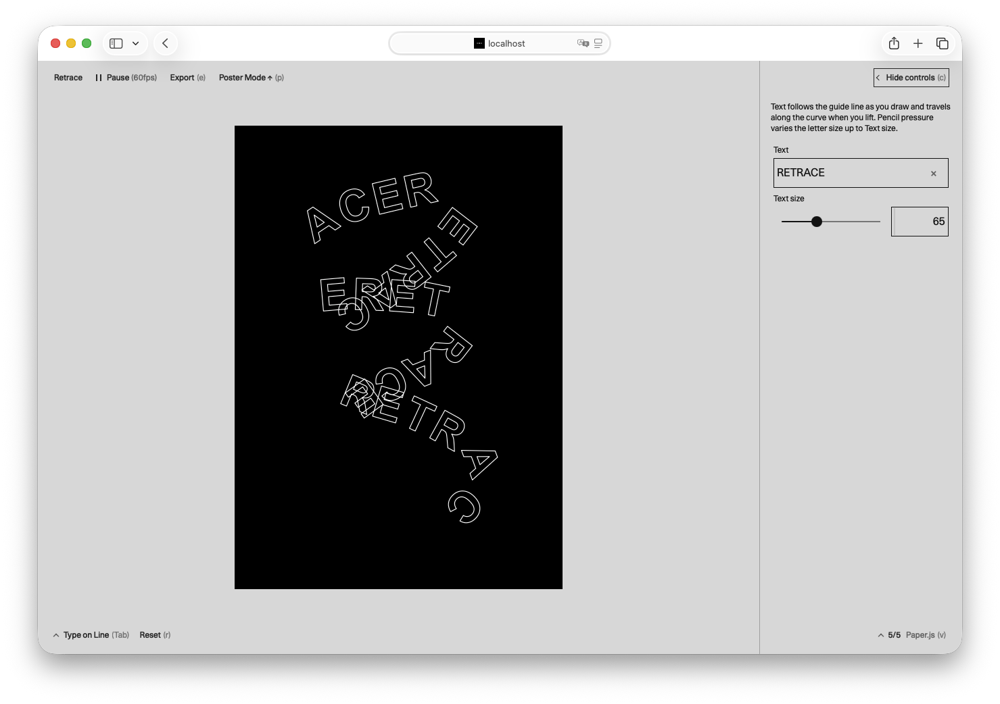

# Retrace

A creative coding workspace for students. Turn an idea into an interactive drawing, animation or visual experiment with an AI coding assistant. Each iteration keeps its code and prompt, so you can revisit how your project evolved.

## Install

Install [Node.js](https://nodejs.org/) (22.12 or newer, includes npm). Open a terminal in this folder and run once:

```sh
npm install
```

For the in-sketch Agent, install and open [Ollama](https://ollama.com/download), then download [Qwen](https://ollama.com/library/qwen3.5:9b):

```sh
ollama pull qwen3.5:9b
```

Keep Ollama running on your computer. If you use the CLI without the app, start it with `ollama serve` in a separate terminal. Ollama is only needed for sketches with an Agent button.

## Run

In the project folder:

```sh
npm run dev
```

Open the **Local** address printed in the terminal. Keep the terminal running; changes appear automatically. Press `Ctrl+C` to stop.

### Open on iPad

Connect the computer and iPad to the same Wi-Fi. Click **Retrace** at the top left to copy the computer’s network address, or copy the **Network** URL from the terminal, including its port (for example, `http://192.168.1.20:5173`). Open that address in Safari on the iPad. Keep the computer and server running.

## Prompt a project

Open this folder in your AI coding assistant and ask it to follow `AGENTS.md`. Describe what you want to see, how it moves and how you interact with it.

Place reference images in a `references/` folder at the project root. Name the files in your prompt and explain what to borrow from them, such as composition, shapes or movement. You can also share a link, or say to proceed without a reference.

To enable the in-sketch **Agent**, explicitly ask for it in your prompt, for example: “Add Agent mode to control line thickness and fade speed.” Without this request, Agent support is not added, including in new iterations of an Agent-enabled sketch.

**New project**

> Create a new p5.js project called “Traces”. Draw white lines on a black background as I drag the mouse or my finger. Slowly fade the lines away. Proceed without a visual reference.

**New iteration**

Select a project and version, open **Versions**, then click the version summary to copy its reference. Paste it into your coding assistant and add your change:

> Starting from this version, make the lines thicker and fade twice as slowly. Save a new iteration.

Previous iterations stay available in the timeline. The in-sketch **Agent** changes only what that version supports; it does not save a new code iteration.

## Engines

- **p5.js** — simple 2D drawing, interaction and animation. A good starting point.
- **Paper.js** — vector shapes, Bézier curves and editable SVG export.
- **Three.js** — GPU rendering, shaders and 3D. This workspace starts with a flat drawing surface.

Choose an engine in your first prompt, or ask the assistant to help you choose.
