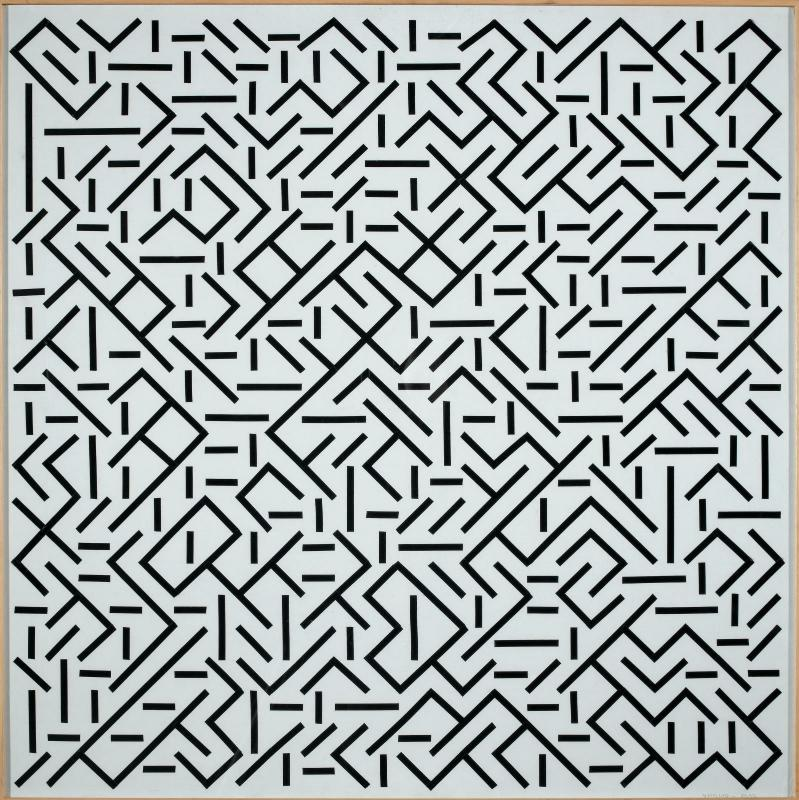
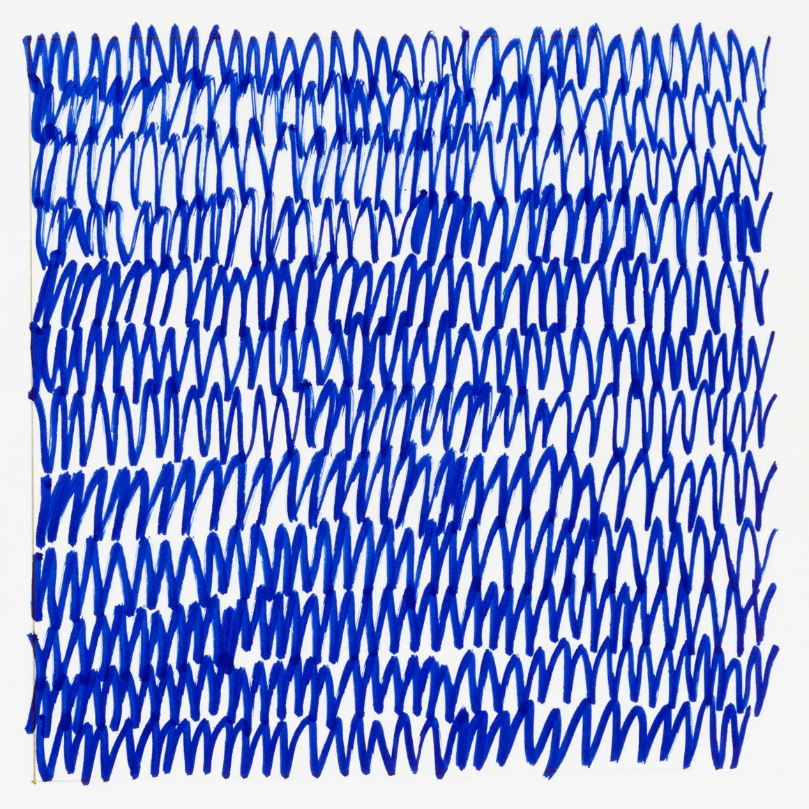
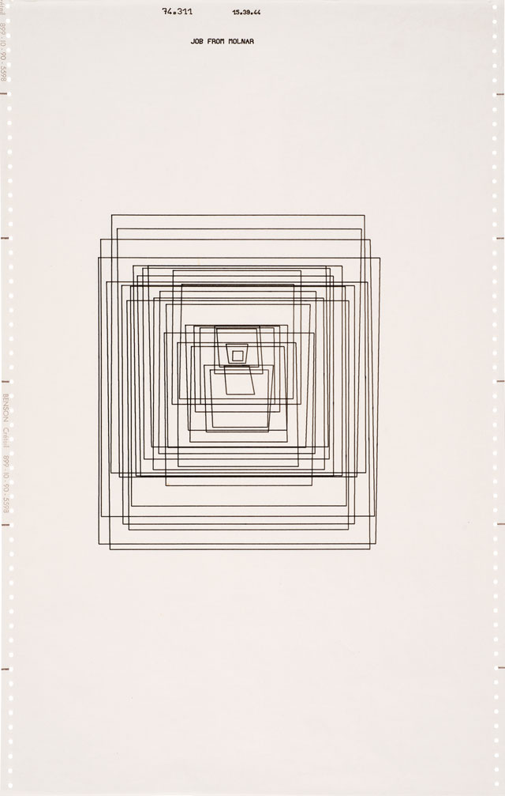

# Mes références — Vera Molnár

Remplace les « … » par tes idées. Pour ajouter une référence, copie un bloc et change l’image.

## Couleurs du sketch

Palette choisie : `noir-blanc`

Change ce nom ici ou indique-le dans ton prompt : « Utilise la palette papier de references.md ».

| Palette | Fond | Formes et contours |
| --- | --- | --- |
| `noir-blanc` | `#000000` | `#FFFFFF` |
| `papier` | `#F4F1E8` | `#1A1A1A` |
| `bleu` | `#F4F1E8` | `#1436C8` |

Pour créer ta palette, ajoute une ligne avec un nom et deux codes couleur. Seule la palette choisie est utilisée ; les autres restent des suggestions.

## Quatre éléments distribués au hasard — 1959

- Ce qui m’intéresse : …
- Ce que je veux essayer : …

## Lettres de ma mère — titre exact à confirmer

- Ce qui m’intéresse : …
- Ce que je veux essayer : …

## Transformation 74.311 — 1974

- Ce qui m’intéresse : …
- Ce que je veux essayer : …
